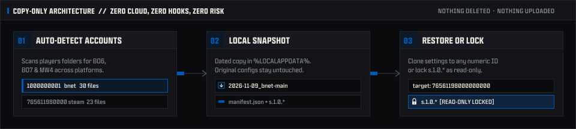
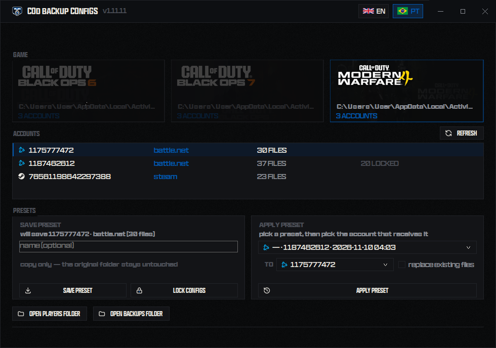

<div align="center">

<a href="docs/screenshot.png">
  
</a>

<br />
<br />


<br />

**Zero-install Windows utility to back up, transfer, and read-only lock local Call of Duty configs across accounts and platforms.**

[Workflow](#-how-it-works) &nbsp;·&nbsp; [Features](#-key-features) &nbsp;·&nbsp; [Preview](#-interface-preview) &nbsp;·&nbsp; [Quick Start](#-quick-start) &nbsp;·&nbsp; [Build](#-building-from-source)

</div>

---

## ⚡ How It Works

<div align="center">
  
</div>

Cod Backup Configs is **100% file-based and copy-only**. It never injects into game memory, never touches binaries, never uploads telemetry, and never deletes source files.

---

## 🎯 Supported Titles & Platforms

| Category | Supported | Details |
| :--- | :--- | :--- |
| **Call of Duty Titles** | **Black Ops 6** · **Black Ops 7** · **Modern Warfare 4** | Auto-detects `players` directories per title + manual folder picker fallback. MW4 is active in this release; BO6/BO7 show grayed out, unclickable |
| **PC Storefronts** | **Battle.net** · **Steam** · **Xbox PC** | Platform inferred from numeric account ID shape (`SteamID64`, `Battle.net`, Xbox) |
| **Protected Configs** | Every settings file of an account (`.swp` swap files excluded) | Instant `ReadOnly` attribute toggle across all account files — `s.1.0.*`, `g.cod25.*`, `g.cod26.*`, whatever the title names them |

---

## ✨ Key Features

- **Single Portable Executable** — Self-contained `.NET 8` win-x64 `.exe`. Embedded artwork, icons, and typography stay in memory — nothing is extracted next to the binary or left on disk.
- **Auto-Detection Across Accounts** — Discovers detected numeric account directories under local Call of Duty `players` paths with one-click refresh and file/lock counters.
- **Dated Copy-Only Presets** — Saves a full account configuration folder into a dated preset with an optional custom label. Original folders remain untouched.
- **Cross-Account & Cross-Platform Migration** — Apply any saved preset to a different account picked from the destination dropdown (e.g., Battle.net → Steam), with an explicit toggle before overwriting existing files.
- **One-Click Read-Only Lock** — Prevents game patches or crashes from resetting your tuned graphics and input. One click marks every settings file of the account (`s.1.0.*`, `g.cod25.*`, `g.cod26.*`, …) read-only — `.swp` swap files stay writable. Unlock anytime in one click.
- **Live Language Switch** — Instant runtime switch between **English** and **Português (BR)** via top-right flags.

---

## 🖥 Interface Preview

<div align="center">
  
</div>

> Designed around an obsidian steel palette (`#0A0B0C` / `#131417`), crisp `1 px` borders (`#212328`), cobalt focus accents (`#0159B3`), deterministic subtle background grain, and memory-loaded **Hitmarker** display typography.

---

## 🚀 Quick Start

1. Launch `Cod Backup Configs.exe` on **Windows 10 / 11 (64-bit)**.
2. Select the game card (**MW4** — **BO6**/**BO7** show grayed out in this release) — or click **choose folder…** if your `players` folder lives in a custom path.
3. Pick an account from the list:
   - **SAVE PRESET** — Saves the selected account's configs as a dated preset; it lands selected in the preset list right after, ready to apply.
   - **APPLY PRESET** — Pick a preset, choose the account that receives it from the TO dropdown (it follows your list selection), and apply.
   - **LOCK CONFIGS / UNLOCK CONFIGS** — Toggles Windows `ReadOnly` on every settings file in that account (all `s.1.0.*`, `g.cod25.*`, `g.cod26.*` files; `.swp` swap files are left alone).

---

## 📁 Local Data Footprint

Everything created by the app stays inside your local Windows user profile — no registry entries, no background services, no temp log files:

| Purpose | Local Path |
| :--- | :--- |
| **Presets** | `%LOCALAPPDATA%\CodBackupConfigs\backups\` |
| **UI Preferences** | `%LOCALAPPDATA%\CodBackupConfigs\prefs.json` |

---

## 🛠 Building from Source

Requires the **[.NET 8 SDK](https://dotnet.microsoft.com/download)** (`win-x64`):

```powershell
dotnet publish src\CodBackupConfig\CodBackupConfig.csproj `
  -c Release `
  -r win-x64 `
  --self-contained true `
  -p:PublishSingleFile=true `
  -p:IncludeNativeLibrariesForSelfExtract=true `
  -p:DebugType=none `
  -p:DebugSymbols=false `
  -o dist
```

Output binary: `dist\Cod Backup Configs.exe` (single file, no `.pdb` sidecar).

---

## 📚 Documentation & Credits

- [`CHANGELOG.md`](CHANGELOG.md) — release history, date-encoded tags (`v1.11.10`, …)
- [`docs/PLAN.md`](docs/PLAN.md) — Detection rules, copy guarantees, and UI layout spec
- [`docs/RESEARCH.md`](docs/RESEARCH.md) — Path layout and config filename references
- [`assets/SOURCES.md`](assets/SOURCES.md) · [`assets/spec/`](assets/spec/) — Embedded art provenance and visual tokens

---

<div align="center">

<sub>Not affiliated with Activision Publishing, Inc., Valve Corporation, or Microsoft Corporation. Game titles, key art, logos, and the Hitmarker typeface belong to their respective owners and are used strictly for visual identification in an unofficial non-commercial utility.</sub>

<sub>Source code released under the <a href="LICENSE">MIT License</a>.</sub>

</div>
